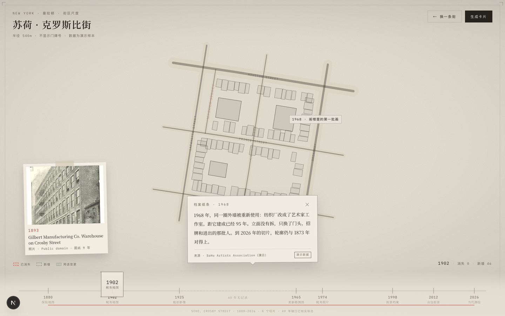
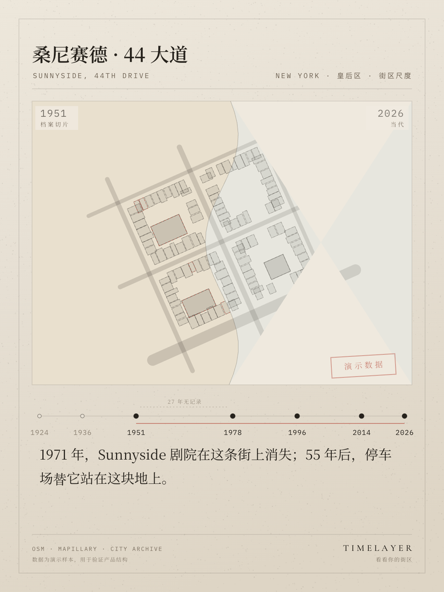

# 时间街道 TimeLayer

> 输入一个地址，看见这条街过去一百年留下的痕迹：旧地图、变化的建筑、档案纸条，
> 以及一张可以分享的街区传记卡片。

这是 GDD v1.0（90 天 MVP）的可运行实现：单城市（纽约）、两个街区样板、
每日三枚书签、地址模糊化、时间卷尺、变化痕迹、档案纸条、卡片导出与 OG 预览。
**不含账号体系**，也不接收用户上传。

## 预览

**街区传记主界面**（时间卷尺停在 1902，左上角是 1893 年的档案图版，档案纸条展开）



**单帧证据**（点开左下角的照片，看作者、许可证和原始条目）


**街区传记卡片**（1080×1440，弯曲裂缝分屏，朱砂印章）



入口、卡片覆盖层与移动端：见 [`docs/preview`](docs/preview)。

---

## 快速开始

```bash
npm install
npm run dev          # http://localhost:4310
npm run check        # M1 / M2 / M4 的验收脚本
npm run build
```

无需任何环境变量即可完整跑通。想启用 LLM 润色档案纸条，复制 `.env.example` 为
`.env.local` 并填入 `DEEPSEEK_API_KEY`；不填也能用，只是叙述停在规则模板上。

---

## 这一版做了什么

| 模块 | 状态 | 位置 |
|---|---|---|
| **M1 地址模糊化** | ✅ 100 条测试地址 120/120 命中，输出 schema 里没有门牌字段 | `src/pipeline/resolve.ts` |
| **M2 时间切片管道** | ✅ 每个街区 7–8 个切片，缺口显式标记、不插值 | `src/pipeline/slices.ts` |
| **M3 地图主界面 + 时间卷尺** | ✅ 双层交叉淡化、缺口空白呼吸、卷尺惯性 + snap | `src/components/MapStage.tsx`、`TimeRuler.tsx` |
| **M4 叙事标注** | ✅ 规则引擎出稿 + Zod 校验 + 年份接地校验；LLM 只能改写 | `src/pipeline/narrative.ts` |
| **M5 卡片生成与分享** | ✅ Canvas 直绘 1080×1440、弯曲裂缝分屏、OG 图 | `src/lib/cardRenderer.ts`、`app/b/[slug]/opengraph-image.tsx` |
| **影像层（单帧证据）** | ✅ 接 Wikimedia Commons 真实档案，按年份浮出照片/图版 | `src/imagery/`、`EvidencePhoto.tsx` |

### 三条硬约束是怎么落到代码里的

1. **地址不进渲染层。**
   `ResolvedBlock` 只有 `centroid` 和 `radiusM`（≥500m），没有 `houseNumber`，
   也没有原始输入。`scripts/check-m1.ts` 会对输出的 JSON 做关键词扫描（`house|postcode|streetAddress`），
   一旦泄漏直接 fail。
2. **时间轴只 snap 到真实年份。**
   拖到缺口中间时，取景框显示「无记录」，地图先降到纸色（200ms 空白呼吸）
   再浮出下一张切片，而不是插值出一帧假的 1963 年。`GAP_YEARS = 25` 是唯一的判定阈值。
3. **没有来源就当虚构处理。**
   `narrativeSchema` 的 `superRefine` 会拒绝「无 source 但不标记虚构」的叙述；
   `groundingIssues()` 提取文本里的所有四位年份，去和事实清单比对，LLM 编一个年份就整句回退。

---

## 目录

```
app/
  page.tsx                     入口：地址输入 + 三枚书签 + 定位呼吸
  b/[slug]/page.tsx            街区传记主界面（SSR metadata）
  b/[slug]/opengraph-image.tsx 1200×630 OG 图（next/og + 子集化中文字体）
  api/resolve                  地址 → 街区（不保存、不回显门牌）
  api/blocks/[slug]/slices     M2 切片探测结果
  api/narrative                M4：无 key 返回模板句，有 key 也只做润色
src/
  domain/types.ts              领域词汇；隐私约束写在类型里
  data/plans.ts                两个街区的手写骨架（街道 / 地标 / 事件 / 切片）
  data/blocks.ts               由骨架生成街区肌理（确定性 PRNG，同一街区每次一样）
  pipeline/                    M1 / M2 / M4
  lib/mapPlan.ts               MapLibre 图层、斑驳描边、变化痕迹的 paint 表达式
  lib/cardRenderer.ts          Canvas 卡片（1080×1440）
  components/                  MapStage / TimeRuler / ArchiveNote / BiographyCard / EntryScreen
  store/player.ts              Zustand：year / sliceYear / visited / dwell / selected
assets/noto-serif-sc-og.otf    OG 用的字子集（363 字，OFL，来自 Google Fonts Noto Serif SC）
scripts/                       M1 / M2 / M4 验收脚本 + 字体子集构建
```

---

## 影像层：真的接了档案

地图左下角那张照片不是生成的，是从 **Wikimedia Commons** 拉的真实档案：

- **两条检索交叉**：地理检索（带坐标的街面照片）+ 类别检索（`Crosby Street (Manhattan)`、
  `Sunnyside, Queens` 里的税照、图版、扫描件）。
- **一个时代留三张**：按 1900 / 1950 / 1990 / 2010 分桶各取最高分的三张，避免「全是 2022 年的街拍」。
  结果是克罗斯比街能拿到 1852 年地图、1893 年《King's Handbook》里的 Crosby 铸铁仓库版画、
  1905 年 Sanborn 图版；桑尼赛德能拿到 1873 年 Beers 地图、**1940 年纽约市税照**、2020 年街面。
- **年份只写真年份**：每张图按 `DateTimeOriginal` 标注；差 15 年就写「距此 15 年」，
  解析不出来就不显示，绝不把 2004 年的照片放到 1978 年的切片上。
- **署名是硬要求**：点开大图有作者、许可证、原始条目链接（多数为 Public Domain，其余 CC BY / CC BY-SA）。

`MAPILLARY_TOKEN` 的适配器也写了，但**这个环境访问不到 graph.mapillary.com**（返回 500），
所以那条路径没有在线验证；它的覆盖只有 2014 年之后，本来也只属于「现在」这一端。

## 关于数据：这是演示样本

纽约两街区（皇后区 Sunnyside / 曼哈顿 SoHo Crosby Street）的**建筑轮廓、事件与切片是
人工构造的演示数据**，不是真实史料。这一点在 UI 上明说了三处：首页页脚、
街区页副标题、卡片上的朱砂印章「演示数据」。

没有接 Nominatim / Mapillary / Sanborn 的原因不是懒：MVP 阶段用两街区把
「地址 → 切片 → 痕迹 → 叙述 → 卡片」整条链路调通，比接十个 API 更能验证产品。
接口已经留好：

- `resolveAddressWith(input, geocoder)` 接受任意 `Geocoder` 实现，返回后仍强制过 `anonymize()`。
- `Slice` 有 `type: 'map' | 'aerial' | 'photo' | 'street'` 与 `source`；影像层的 `Evidence`
  已经接进来了，换数据源只需要再实现一个 `ImagerySource`。
- `ChangeEvent.provenance` 区分 `archive / demo / inferred`，真实史料接进来只需改这一个字段。

---

## 视觉与交互实现要点

- **地图是纸，不是屏。** MapLibre 只画矢量：街道是双线（路基 + 墨线），建筑是淡填充 + 细描边，
  外加 SVG 噪声、暗角、裁切标记、内框。整张图不依赖任何在线瓦片，离线也能渲染。
- **切换 = 翻描图纸。** 两套图层槽 `a/b` 交替：新槽换 filter、旧槽 1→0 新槽 0→1，
  450ms `easeOutQuint`（近似 `cubic-bezier(.16,1,.3,1)`）。缺口区间先掉到 0，停 180ms，再浮上来。
- **痕迹是沉积物。** 消失的建筑留下朱砂虚线 + 斜线填充，透明度随「离开年份的距离」线性衰减；
  新增建筑是铜绿细虚线；用途变更叠一层点状纹理。都不是图钉。
- **卷尺有不均匀刻度。** 位置按真实年份线性映射，所以 1951→1978 的 27 年缺口自然占出一大段空白，
  并用虚线 + 「27 年无记录」标出来。松手后带过冲回弹（`easeOutBack`）到最近的真实节点。
- **卡片在 Canvas 里画，不在 DOM 里截。** 预览图就是导出图，没有 `html-to-image` 的字体丢失问题，
  也不会因为地图 canvas 被污染而导不出来。

---

## 已知未做（按优先级）

1. **影像层的图不在街区本身上。** Commons 的地理检索能保证「这条街附近」，
   但 1893 年的版画和 1940 年的税照是按街区类别找到的，不一定正对某一栋楼。
   卡片和纸条说的是建筑本体，照片说的是街区——两者在文案里分开写了，不要混着用。
2. **只做了 2 个街区。** GDD 要求「两个街区起步」，这里守住了；扩城市要先扩配准与叙事模板。
3. **移动端只到「能用」。** 窄屏下年份标签会自动抽稀，但还没有做手势上的捏合时间轴。
4. **没有真实埋点。** `dwell` 已经在内存里统计停留时长（决定卡片主图年份），但没上报。
